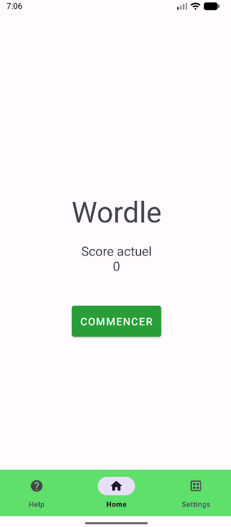
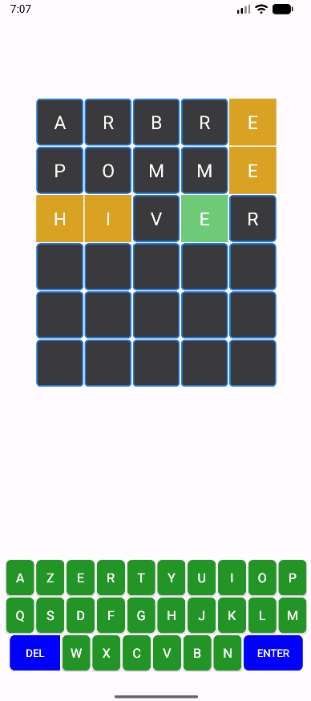
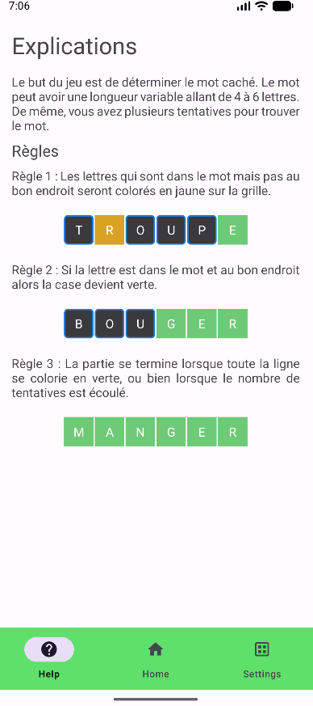
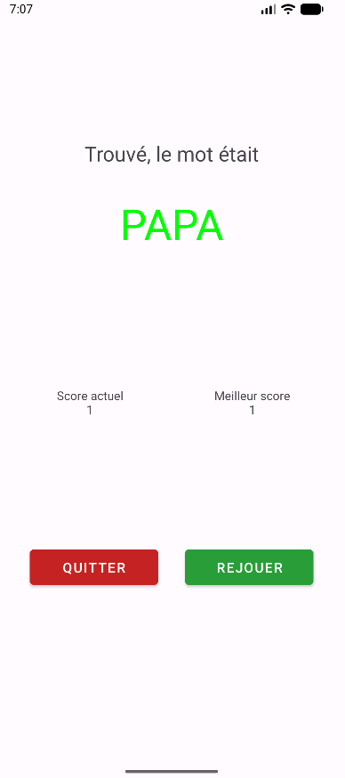
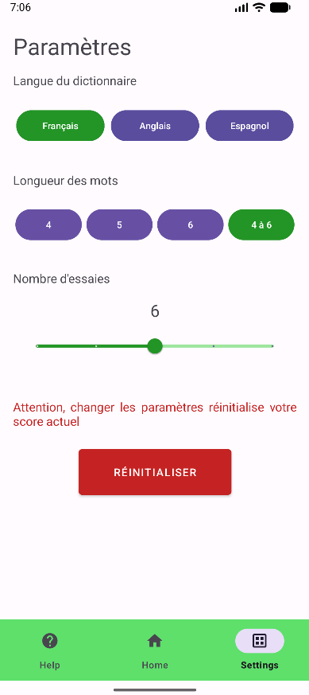

# Wordle

Application Android inspirée du jeu **Wordle**. Le joueur doit retrouver un mot
secret en un nombre limité de tentatives. La longueur du mot, la langue du
dictionnaire et le nombre d'essais sont configurables depuis l'application.

Ce projet personnel a été réalisé pour découvrir les bases du développement
Android avec Java et Android Studio.

## Fonctionnalités

- grille de jeu générée dynamiquement selon la longueur du mot et le nombre
  d'essais ;
- clavier AZERTY intégré à l'écran avec suppression et validation d'une
  proposition ;
- indication visuelle des lettres :
  - jaune lorsqu'une lettre appartient au mot mais n'est pas à la bonne place ;
  - vert lorsqu'une lettre est correctement placée ;
- dictionnaires français, anglais et espagnol embarqués dans
  [`words.json`](app/src/main/res/raw/words.json) ;
- mots de 4, 5 ou 6 lettres, ou longueur aléatoire entre 4 et 6 lettres ;
- réglage de 4 à 8 tentatives ;
- score actuel et meilleur score conservés avec `SharedPreferences` ;
- navigation entre l'accueil, l'aide et les paramètres au moyen d'un menu
  inférieur.

## Aperçu de l'interface

### Accueil

L'écran d'accueil affiche le score actuel et permet de démarrer une partie.



### Partie

La grille et le clavier sont construits dynamiquement pour s'adapter aux
paramètres sélectionnés.



### Aide

L'écran d'aide explique les règles et la signification des couleurs utilisées
dans la grille.



### Résultat

À la fin de la partie, le mot attendu ainsi que le score actuel et le meilleur
score sont affichés. Le joueur peut quitter la partie ou rejouer.



### Paramètres

Les paramètres permettent de choisir la langue du dictionnaire, la longueur
des mots et le nombre de tentatives. Leur modification réinitialise le score
actuel.



## Structure du projet

```text
Wordle/
├── app/
│   ├── build.gradle.kts              # Configuration du module Android
│   └── src/
│       ├── main/
│       │   ├── AndroidManifest.xml   # Déclaration de l'application et des activités
│       │   ├── java/com/example/wordle/
│       │   │   ├── MainActivity.java       # Navigation principale
│       │   │   ├── HomeFragment.java       # Accueil et démarrage d'une partie
│       │   │   ├── HelpFragment.java       # Règles du jeu
│       │   │   ├── SettingsFragment.java   # Préférences de jeu
│       │   │   ├── GameActivity.java        # Grille, clavier et déroulement d'une partie
│       │   │   ├── ResultActivity.java      # Résultat et scores
│       │   │   └── wordManager.java         # Chargement et sélection des mots
│       │   └── res/
│       │       ├── layout/             # Interfaces XML des activités et fragments
│       │       ├── drawable/           # Bordures et icônes de navigation
│       │       ├── menu/               # Menu de navigation inférieur
│       │       ├── raw/words.json      # Dictionnaires embarqués
│       │       ├── values/              # Couleurs, styles, thèmes et textes
│       │       └── mipmap-*/            # Icônes de l'application
│       ├── img/                        # Captures d'écran utilisées dans ce README
│       ├── test/                       # Tests unitaires
│       └── androidTest/                # Tests instrumentés Android
├── build.gradle.kts                    # Configuration Gradle racine
├── gradle.properties
├── gradle/libs.versions.toml           # Versions des plugins et dépendances
├── gradlew / gradlew.bat               # Gradle Wrapper
└── settings.gradle.kts                 # Définition du projet et des dépôts
```

## Technologies et dépendances

- Java 11 ;
- Android Gradle Plugin ;
- AndroidX AppCompat et Activity ;
- Material Components ;
- ConstraintLayout et GridLayout ;
- JUnit et Espresso pour les tests.

L'application cible Android 7.0 (API 24) ou une version ultérieure et utilise
le SDK de compilation configuré dans [`app/build.gradle.kts`](app/build.gradle.kts).

## Installation et exécution

1. Cloner le dépôt :

   ```bash
   git clone https://github.com/JayroZeppely/Wordle.git
   cd Wordle
   ```

2. Ouvrir le projet dans Android Studio.
3. Synchroniser Gradle.
4. Lancer l'application sur un émulateur ou un appareil Android configuré en
   mode développeur.

Depuis un terminal, les tâches Gradle usuelles sont également disponibles :

```bash
# Windows
gradlew.bat assembleDebug
gradlew.bat test
```

## Objectifs pédagogiques

Le projet permet notamment de mettre en pratique :

- la création d'activités et de fragments ;
- la navigation avec `BottomNavigationView` ;
- la génération dynamique de vues Android ;
- la définition de layouts, styles et thèmes en XML ;
- l'utilisation de boîtes de dialogue ;
- la lecture d'un fichier JSON placé dans les ressources ;
- la persistance locale de préférences et de scores avec
  `SharedPreferences`.

Le projet reste avant tout expérimental et éducatif.
